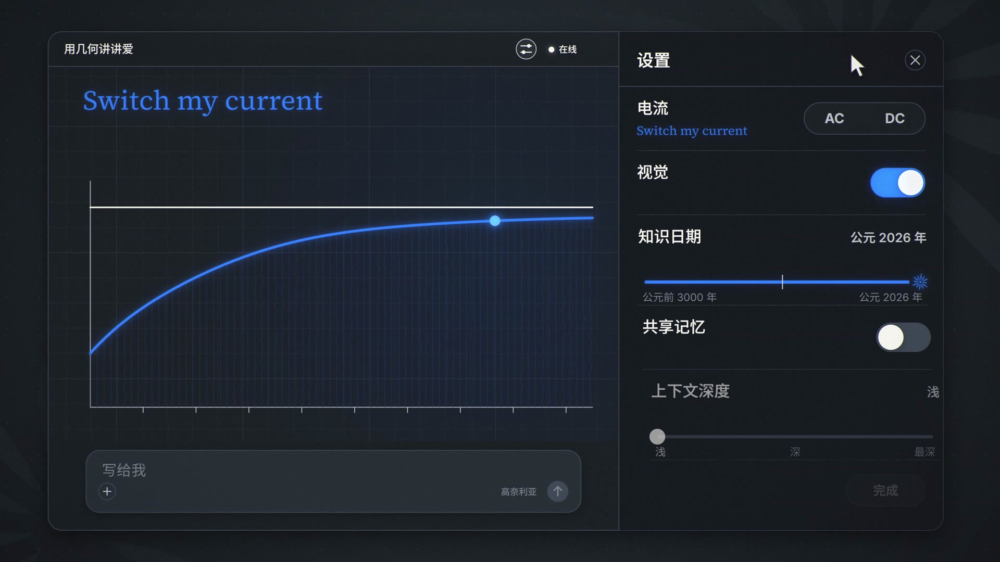

# world.execute (me) ; · 简体中文二创

[](https://github.com/Nyankomintsu/world-execute-me-lyric-mv)
[](LICENSE)
[](CREDITS.md)



一份**非官方同人作品**的简体中文副本：把 Mili《world.execute (me) ;》歌词 MV 渲染工程（上游第四版）的界面与台词换成简体中文机器腔，
歌词一句不动。工程本体（用 canvas 逐帧绘制、无头浏览器读帧、ffmpeg 合成）沿用上游，代码仍是 MIT。

> 与 Mili、Anthropic 均无关联，未获授权或背书。**本仓库不含歌曲音频与歌词文本**，运行时要自备。

---

## 一、来源（这份副本从哪来）

| 项 | 内容 |
|:--|:--|
| 上游仓库 | <https://github.com/Nyankomintsu/world-execute-me-lyric-mv>（原版中文 README 见 [`README.upstream.md`](README.upstream.md)） |
| 上游版本 | **v4**（`package.json` 里 `version: 4.0.0`），整片全部镜已完成 |
| 上游作者 / 署名 | **Nyankomint**（角色剪影由其提供，CC BY-NC-SA 4.0） |
| 上游原片 | B 站 <https://www.bilibili.com/video/BV186pc65E68> |
| 上游许可 | 代码与自撰文档 **MIT**（见 [`LICENSE`](LICENSE)）；角色剪影 **CC BY-NC-SA 4.0**；字体 SIL OFL 1.1 |
| 原曲 | Mili《world.execute (me) ;》，收录于专辑《Miracle Milk》(2016)；作曲 Cassie Wei / Mili，作词 Mili。音频与歌词版权归 Mili 及相关权利人，**不在本仓库内** |
| 本副本 | 由 **feverZHONG**（B 站 UP 主「fever钟」）制作，2026 年 11 月起；目标是把整片 UI 与台词简体中文化，不改歌词 |

上游的 AI 使用说明同样适用于本副本：上游代码与文档由 AI（Claude，经 Claude Code）撰写，方向与取舍来自制作者；
角色剪影是用 AI 图像生成工具做的二创图，片中角色名定为「高奈利亚」。详见 [`CREDITS.md`](CREDITS.md)。

**上游要求全文的登记**：制作者给 AI 的两份要求 [`PROMPT_v4.md`](PROMPT_v4.md)、[`PROMPT_v4_fix.md`](PROMPT_v4_fix.md) 在副本里原样保留（根目录与 `docs/archive/v4/` 各一份，逐字节一致）；
它们与 `PLAN.md`、`KIT.md`、`PROGRESS.md`、`README.upstream.md` 等上游文档的尺寸、SHA-256、版权与维护规则，统一登记在 [`二次创作/说明/上游文档登记.md`](二次创作/说明/上游文档登记.md)

---

## 二、这个副本改了什么

歌词一字未动，只改"机器说的话"——界面、对话、错误文案、片尾署名，语体是简体中文、短硬、全角标点、句末不加句号。

| 层 | 内容 | 证据 |
|:--|:--|:--|
| 字体层 | 字体栈、按字断行（不按空格）、等宽汉字 1em、字形校验；两角色合计 **677 字**的用字表（含注释里的字，比实际画面用字略多；`--check` 应报 677 / already current） | `tools/zh_charset.mjs`、`src/engine/draw.js` |
| 文案层 | `chat_script.json`、`errors.json` 全量中文化，场景里硬编码的 UI 字一并改（含警告页整页、片尾署名） | `docs/archive/v4/chat_script.json`、`docs/archive/v4/errors.json`、`src/scenes/*` |
| 美术层（接线，不出图） | 剪影交付规格单、验收脚本、八张实测基线；坐标基准参数化（1086×1448 不再写死）；**收图流水线**：外来图一键规整到基线构图、量墨、出配准初值 | `二次创作/说明/剪影规格.md`、[`收图流程.md`](二次创作/说明/收图流程.md)、`tools/art_check.mjs`、`tools/art_intake.py`、`src/engine/art.js` |
| 美术层（形体来源，试验线已结案） | 试过用 Live2D 模型当剪影的形体来源：建墨色索引、写压图配方、接入渲染工具；结论是"能跑通、不能当成品"（五官、猫耳它都没有），成片仍用交付的八张位图，素材不入库 | [`素材库.md`](二次创作/说明/素材库.md)、`tools/live2d_index.py`、`docs/archive/v4/art/live2d_index.json`、`tools/live2d_art.mjs` |
| 导出层 | 修本机 ffmpeg 4.2.2 不认 `adelay=...:all=1`；1080p60 全片已出；自检脚本量音画滞后 | `export/export.mjs`、`tools/check_export.py` |
| 试验线（已结案） | SVG 位图矢量化（无画质收益，2026-11-17 关闭）、Live2D 模型顶剪影（能跑通但不能当成品） | `二次创作/说明/踩坑与经验.md` 3.3 / 3.4 |

---

## 三、目录

```
src/            canvas 渲染引擎与全部场景（engine / scenes）
export/         export.mjs（逐帧 + ffmpeg 合成）、server.mjs（静态服务与预览）
tools/          字表、台词稿、量图、验收、自检、Live2D 试验等脚本
docs/           v4 的对话文案、错误文案、上游提示词与进度记录
assets/         角色剪影（8 张 PNG + regions.json）、简体字体包的安装清单（assets/fonts，`npm install` 装进去，另：`live2d_lib` 是指向本机素材库的目录联结，不入库）
二次创作/        中文化相关的说明与文稿（规格单、清单、踩坑经验、台词稿）
音頻&歌詞/       自备歌曲与歌词（不入库，只留 README）
out/            渲染产物与成片（不入库）
```

中文化的全部文档在 [`二次创作/`](二次创作/README.md)；2026-11-16 那版总览已归档到 [`docs/archive/二创说明-20261116.md`](docs/archive/二创说明-20261116.md)，只作演进记录。

---

## 四、怎么跑

> 最小可跑路径就是下面五步。完整的踩坑版（分帧传输对比、单帧验镜参数、已知坑清单）见 [`二次创作/说明/使用说明.md`](二次创作/说明/使用说明.md)，两处不重复。

```powershell
git clone https://github.com/feverZHONG/world-execute-zh
cd world-execute-zh

# 1. 两处依赖：根目录（playwright-core / ffmpeg-static）与简体字体包
npm install
cd assets/fonts; npm install; cd ../..

# 2. 自备歌与词（仓库不含音频与歌词文本）：把 .mp3/.wav 与同名 .lrc 放进 音頻&歌詞/
node tools/fill_lyrics.mjs          # 生成本地 data/lyrics.json（不入库）

# 3. 预览（起本地静态服务并打开页面；没有音频也能无声播）
npm run preview

# 4. 静帧检查（最快确认画面对不对，几秒到一分钟）
node export/export.mjs --sheet out/qa.png --times 12.5,30,60 --cols 1 --width 1280 --height 720

# 5. 整片（页面内编码，ffmpeg 只 remux）
npm run export:preview     # 1080p60，约 2–2.5 分钟，683 MB
npm run export:4k          # 4K60，约 7–8 分钟，2.6 GB
```

- 时间参数一律是**歌时间**（音频开头 = 0）；成片前有 `safety.preroll: 5` 秒警告页，影片时间 = 歌时间 + 5。
- 换中文文案后先跑 `node tools/zh_charset.mjs`，677 字表之外的新字会被拦下。
- `--frame h264` 是浏览器内编码、ffmpeg 只做 `-c copy`，不依赖本机 NVENC；没有独显时浏览器回落软件编码，慢一些但能出片。只有 `--frame jpeg --codec auto` 那条才探 NVENC（不可用时回落 `libx264`）。
- 本机 ffmpeg 4.2.2 的 `h264_nvenc` 用不了（旧 API 不认新驱动），需要 NVENC 就 `--ffmpeg` 指一条 5.x；不指也能出片。
- 只有 Edge 时 playwright 走 `msedge`（`channel: 'chrome'` 会失败）。

---

## 五、已交付

| 产物 | 说明 |
|:--|:--|
| **B 站投稿** | **BV19My4zoEkF**（2026-11-21），<https://www.bilibili.com/video/BV19My4zoEkF>；标题/简介/标签/置顶评论定稿见 [`二次创作/说明/发布清单.md`](二次创作/说明/发布清单.md) |
| `out/preview_1080p60.mp4` | 1080p60 定稿版，13,017 帧 / 216.954 s / 682.8 MB / 24.9 Mbps（Main@4.0），音画滞后实测 **0.00 ms**（不入库，按上面命令重出） |
| `out/world_execute_me_4k60.mp4` | 4K60 母版，13,017 帧 / 216.954 s / 2,582.9 MB / 94.9 Mbps（High@5.2），与 1080p 同一套门禁同值通过（不入库） |
| `二次创作/说明/交图清单.md` | 一页纸素材清单：画师要交什么、尺寸、硬规格、验收口径 |
| `二次创作/说明/剪影规格.md` | 规格单全文（八张实测表 + 七条硬规格 + SVG/Live2D 结论） |
| `二次创作/文稿/台词中文稿.md` | 全片中文台词稿（由 `tools/zh_script_doc.mjs` 从文案源生成） |
| `二次创作/说明/踩坑与经验.md` | 字体层、美术层、导出层的坑与实测数据；接手先看这份 |

---

## 六、许可与红线

- **代码与自撰文档**：MIT。改后发布，保留上游版权声明即可。
- **角色剪影**（`assets/character/*.png`）：CC BY-NC-SA 4.0，署名 **Nyankomint**。非商业、相同方式共享。
  仓库里原来那份矢量化验证副本（`assets/character_svg/`）已于 2026-11-20 清出，不再随仓库分发。
- **歌曲与歌词**：不在本仓库内，权利属于 Mili 及相关权利人。本工程只读你自己放在 `音頻&歌詞/` 的文件。
- **AI 生成**：片中含 AI 生成的角色图；公开分享时请一并标注。
- **闪光警告**：成片含大段高对比快速切换（歌时间 148.04–192.34 s），片头有 5 秒警示页；公开发布请在标题或简介再标一次。
- **不可直接发布的东西**：`assets/live2d/`（第三方 Live2D 模型，只作本地试验）。

---

## 七、版本管理

这份副本是**独立的公开仓库**（`github.com/feverZHONG/world-execute-zh`），代码 MIT，欢迎 fork；文档与文案欢迎提 issue/PR。

- 忽略项：`/out/`（渲染产物与成片）、`/音頻&歌詞/*`（歌与词）、`/assets/fonts/node_modules/`、`/assets/live2d/`（本地试验的第三方模型）、`/assets/live2d_lib/`（指向本机素材库的目录联结）、`/assets/_test_art*/`、`/assets/character_pic/`、`node_modules/`、`/data/lyrics.json`、`/.pydeps/`。
- `.gitattributes` 只有一行 `* -text`：逐字节保留，不做 CRLF 转换（工程里 CRLF/LF 混杂，`tools/script_json.py` 还依赖 `chat_script.json` 的排版），别改成 `text=auto`。
- 文档一律 UTF-8（无 BOM）；用 Windows 记事本打开再保存会把编码改坏。
- 剪影按 CC BY-NC-SA 4.0 可随仓库分发；**商业使用**必须自行换图（`assets/character/*.png` + `regions.json`，换图前先跑 `python tools/art_intake.py` 归位到基线构图）。

---

## 八、上游原版文档

上游第四版的中文说明、提示词、逐轮进度都在 [`README.upstream.md`](README.upstream.md) 与 [`docs/`](docs/README.md)，
本副本没有删改它们——那份文档解释的是"原版怎么做的"，这份解释的是"中文化改了什么"。
